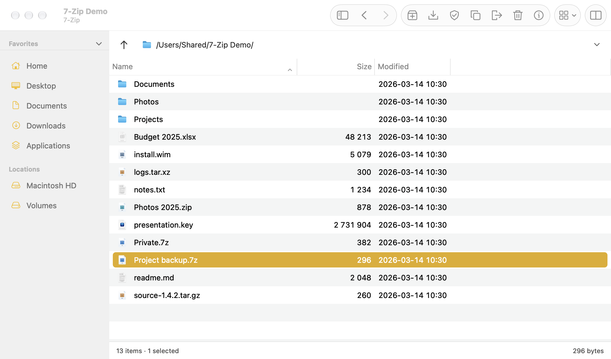
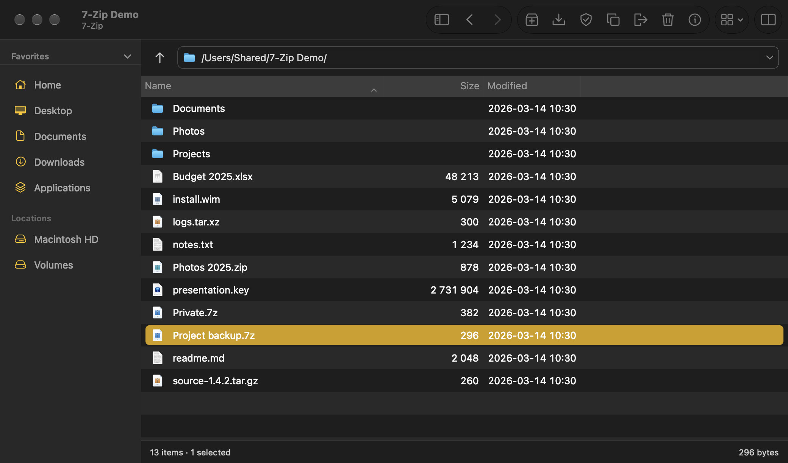
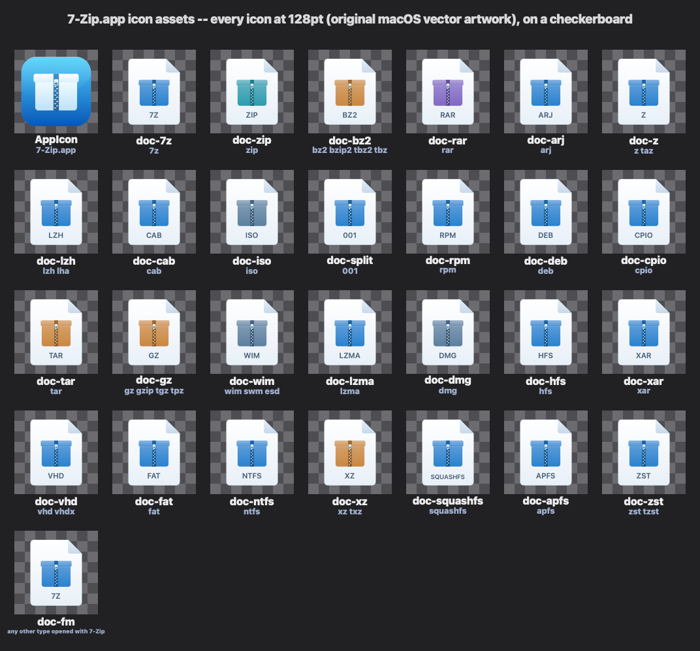

# 7-Zip for Mac

A native macOS archive manager built on the real **7-Zip 26.04** engine. A unified
AppKit toolbar, translucent sidebar, SF Pro typography, and original icons give it
a familiar Mac feel, with the full archive tools underneath.

**Version 1.3.0 · macOS 14 or newer · Apple Silicon and Intel**

[Download the signed release](https://github.com/elliotttate/7zip-mac/releases/latest)

<p align="center">
  <br>
  
</p>

## Features

- Browse and edit archives like folders, including nested archives: 7z, ZIP, RAR,
  TAR, GZip, BZip2, XZ, Zstandard, CAB, ISO, DMG, WIM, MSI, RPM, DEB, APFS, VHD,
  and the other formats supported by 7-Zip.
- Create archives with compression settings, AES-256 encryption, encrypted file
  names, multi-volume output, and self-extracting Windows archives.
- Extract, test, calculate checksums, benchmark, split, combine, and view properties.
- One or two panels, four view modes, sortable columns, folder history, favorites,
  keyboard shortcuts, and 93 languages.
- Finder context menus, Quick Actions, archive document icons, and Quick Look previews.
- System light/dark appearance, native scrolling, rounded accent-color selections,
  and native Settings controls.
- An option to exclude Mac resource forks and metadata when sharing archives.

## Original icons

The app, archive, folder, and toolbar artwork is original and free under
[CC0](Mac/Resources/Icons/LICENSE.md). The icons are drawn at each Retina size from
vector paths; macOS supplies system sidebar symbols at runtime.

<p align="center"></p>

## Install

Download `7-Zip-26.04-macOS-1.3.0.dmg` from
[Releases](https://github.com/elliotttate/7zip-mac/releases/latest), open it, and drag
**7-Zip** into **Applications**. The release contains both Apple Silicon and Intel slices.

## First launch: Gatekeeper

The release is **Developer ID signed, notarized by Apple, and stapled**. The app,
framework, four extensions, and disk image are signed; no quarantine workaround
is needed. The `.sha256` release asset lets you verify the download.

To enable Finder integration, use **Options ▸ 7-Zip ▸ Integrate 7-Zip to shell context
menu**, or **System Settings ▸ General ▸ Login Items & Extensions**. File associations
are optional in **Options ▸ System**.

## Build and contribute

Swift and AppKit, with no third-party dependencies. With Xcode and XcodeGen installed:

```sh
export DEVELOPER_DIR=/Applications/Xcode.app
Mac/scripts/build.sh --release
Mac/scripts/test.sh
```

The developer scripts produce ad-hoc signatures by default. See
[Building](docs/building.md), [Testing](docs/testing.md),
[Releasing](docs/releasing.md), and [Native macOS design](docs/macos-design.md).
The design document records the screenshot method and the remaining migration of
historical Windows appearance tests.

Update checks use this repository's releases. Disable startup checks in
**Options ▸ macOS**. Bug reports belong in this repository; use
[the security policy](SECURITY.md) for vulnerabilities.

## Credits and license

This is an independent, unofficial project, based on
[Yurii Synyshyn's macOS port](https://github.com/yrambler2001/7zip-macos)
of [Igor Pavlov's 7-Zip](https://www.7-zip.org/). The native design revision and
original artwork are by Brian Tate, with Codex assistance. The original macOS port
was developed with Claude Code assistance; its development history is retained in `ai/`.
This project is not affiliated with or endorsed by Apple, Igor Pavlov, or the 7-Zip project.

7-Zip is Copyright (C) 1999–2026 Igor Pavlov; the original macOS port is Copyright
(C) 2026 Yurii Synyshyn. The code is GNU LGPL 2.1 or later, with BSD portions and the
unRAR restriction. See [LICENSE](LICENSE), [DOC/License.txt](DOC/License.txt),
[NOTICE](NOTICE), and the original artwork's [CC0 dedication](Mac/Resources/Icons/LICENSE.md).
